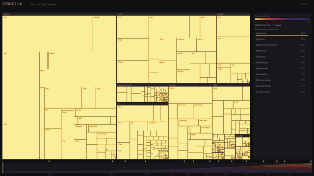
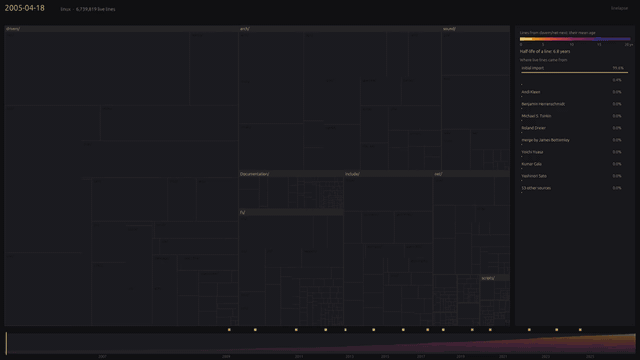
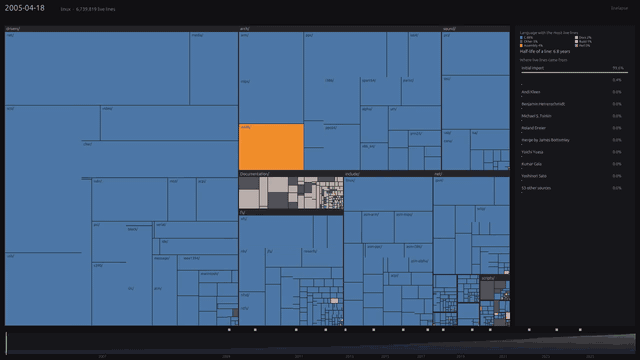
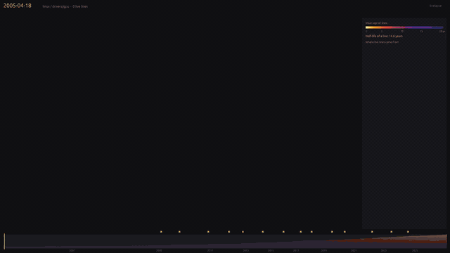

# linelapse

**Replay a git repository's history, line by line.** Every directory is a tile sized by its live lines and coloured by their mean age. Drag through twenty years of history at 120 fps, zoom into any directory, and see which maintainer trees brought the code in.



*The Linux kernel from v2.6.12 (2005) to November 2026: yellow is fresh code, violet is old. Recorded with `linelapse --record`.*

## Numbers, on the Linux kernel

77,605 mainline commits, 172,609 files ever, 92 million lines ever written, on a 14-core Mac:

| | |
|---|---|
| Full indexing | 32 s |
| Cache on disk | 126 MB |
| Playback | 120 fps, frame p95 under 10 ms |
| Jump to any commit | under 0.3 ms |
| Accuracy | 0 mismatches over 97,316 files, checked against git at 4 commits (`--check`) |
| 20 s video at 1080p | rendered in 6 s |

## What you see


- **The map.** A treemap of the repository at the current commit. Tiles keep their place while you scrub, so you watch directories grow, shrink and age.
- **The timeline.** Live lines stacked by the year they were written. Hover it to see how much of the code still dates from the first year.
- **Key moments.** Markers on the commits that changed the most lines. Click one to jump there.
- **Where code came from.** The side panel ranks the sources of the live lines in view: the maintainer tree named in each merge (`netdev/net-next`, `drm/drm`...), the merged branch, or the author of a direct commit. It updates live during playback.
- **A source's territory.** Click a source: tiles keep the age colour of that source's own lines and fade where it owns less. Its commits light up on the timeline.
- **Half-life.** How long it took for half of the lines ever written in the current view to disappear (Kaplan-Meier, with lines still alive censored at HEAD). Linux: 6.8 years. `drivers/gpu`: 14.6 years.
- **Languages.** Press `l` to colour tiles by the language with the most live lines.

### Modes

| A source's territory | Languages | Zoom on a subsystem |
|---|---|---|
|  |  |  |
| `--source davem/net-next`: the networking tree owns `drivers/net` and `net/`; everything else fades. | `--color language` (or `l`): Devicetree takes over `arch/arm*`, Rust appears in `rust/`. | `--path drivers/gpu`: `amd/` grows fresh and yellow while `radeon/` turns violet. |

## Install

**Prebuilt binaries** for macOS (Apple Silicon, Intel) and Linux (x86_64, arm64) are on the [Releases page](https://github.com/antoinehoriot/linelapse/releases). Extract the archive and run `./linelapse`.

- macOS: the binaries are not signed or notarized. If macOS blocks one, run `xattr -d com.apple.quarantine linelapse` once.
- Linux: needs glibc 2.35 or newer (Ubuntu 22.04+, Debian 12+) and the GPUI runtime libraries. Debian/Ubuntu: `sudo apt install libxkbcommon-x11-0 libwayland-client0 libx11-xcb1 libxcb1 libfontconfig1 libfreetype6 libvulkan1`.

**With Cargo:**

```sh
cargo install --git https://github.com/antoinehoriot/linelapse
```

At runtime, `git` must be on the PATH; `ffmpeg` is only needed for MP4/GIF export.

## Build from source

Prerequisites:

- Rust stable via [rustup](https://rustup.rs) (tested with 1.96 on macOS and 1.99 on Linux; the crate uses the 2024 edition).
- `git`.
- macOS: the Xcode Command Line Tools (`xcode-select --install`). The full Xcode Metal Toolchain is not needed: GPUI is built with its `runtime_shaders` feature.
- Linux (Debian/Ubuntu): `sudo apt install build-essential pkg-config libxkbcommon-dev libxkbcommon-x11-dev libwayland-dev libx11-xcb-dev libxcb1-dev libfontconfig-dev libfreetype-dev libvulkan-dev`.

```sh
git clone https://github.com/antoinehoriot/linelapse
cd linelapse
cargo build --release --locked
./target/release/linelapse .            # open this repository's own history
```

The first build compiles GPUI and its dependencies (45 s from a fresh clone on a 14-core Mac; slower machines take longer). Later builds are incremental.

For development:

```sh
cargo install cargo-nextest             # once
scripts/check.sh                        # fmt, clippy -D warnings, full test suite
scripts/docker-linux.sh                 # build + test + --check + --record on Linux, in Docker
PLATFORM=linux/amd64 scripts/docker-linux.sh   # same on x86_64
```

## Usage

```sh
linelapse https://github.com/torvalds/linux    # clones into the cache, indexes, opens
linelapse ~/code/my-repo                       # a local repository
linelapse . --at 0.3 --path src                # 30% into history, zoomed on src/
linelapse . --source netdev/net                # open on a source's territory
linelapse . --color language                   # open in language mode
linelapse . --check                            # verify the index against git, no window
linelapse . --rebuild                          # rebuild the cache
```

Keys: space play/pause, ← → one commit (shift: 500), `l` age/language, esc or backspace to go back. Click a directory to zoom in.

The cache lives in `~/Library/Caches/linelapse/` (macOS) or `~/.cache/linelapse/`, and is rebuilt when HEAD changes. Remote repositories are bare-cloned under `repos/` there and fetched on later runs.

### Record a video

```sh
linelapse ~/code/linux --record linux.mp4                        # 1920x1080, 60 fps, 20 s
linelapse ~/code/linux --record linux.gif --size 1280x720 --seconds 12
linelapse . --record frames/ --source netdev/net --at 0.5        # PNG frames, from mid-history
linelapse . --record langs.mp4 --color language
```

Videos are rendered offscreen, with no window and no screen-recording permission, using the same layout, colours and panel as the app. MP4 and GIF need `ffmpeg`; a directory gets PNG frames.

## How it works

1. One `git log -p -U0 --first-parent` process per core, each on a slice of history.
2. Every line gets a birth commit and a death commit. Events are run-length encoded per (commit, file).
3. Files are numbered in path order, so every directory is a contiguous id range.
4. The viewer keeps per-file state with checkpoints: a jump replays a few hundred commits at most.
5. The side panel and the territory view are live trackers updated on every step. Full rescans (new view, new source, long jump) run on a background thread and catch up with the playhead when they land, so they never block a frame.

## How it compares

- [Gource](https://github.com/acaudwell/Gource) animates who touched which files; linelapse shows the state of the code (age, origin) and jumps to any commit instead of playing forward.
- [git-of-theseus](https://github.com/erikbern/git-of-theseus) plots code by the year it was added; the cohort timeline and the half-life come from it, made interactive and spatial here.
- [Hercules](https://github.com/src-d/hercules) computes line burndown with rich per-developer analyses; linelapse indexes the same first-parent history of Linux in 32 s and lets you browse it.

## Known limits

- Lines are dated by when they reached the mainline (often a merge), not by their author's commit.
- Renames are not followed (a rename is a deletion plus a creation). Binary files and submodules are ignored.
- The cache is rebuilt from scratch when HEAD changes (not incremental yet).
- The window is tested on macOS only. On Linux (arm64 and x86_64, in Docker via `scripts/docker-linux.sh`), the build, the test suite, `--check` and `--record` pass; the window itself has not been tried on a Linux desktop yet.

## License

MIT. Videos embed the Ubuntu Light font (Ubuntu Font Licence 1.0) via `epaint_default_fonts`.
